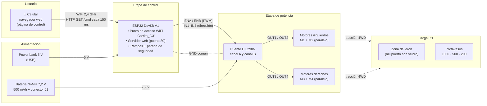
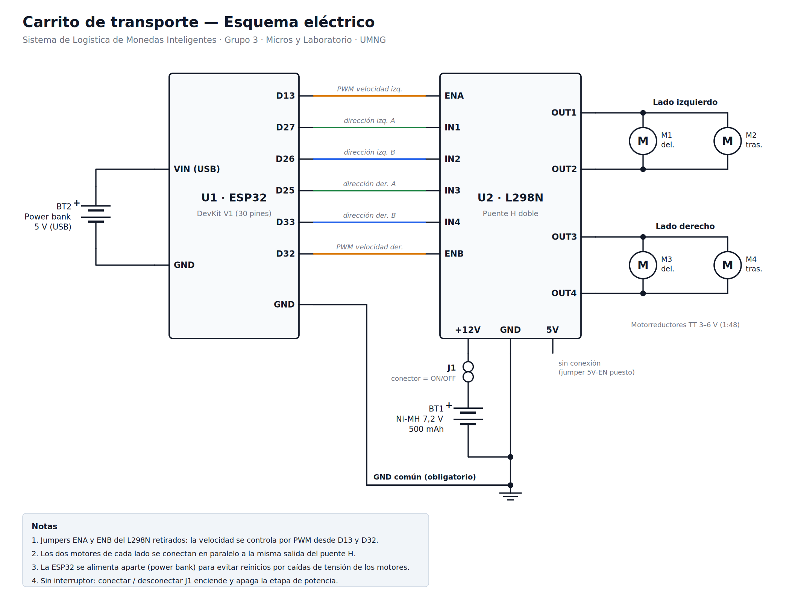
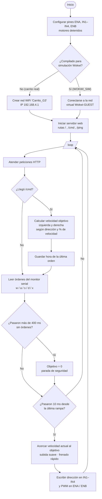
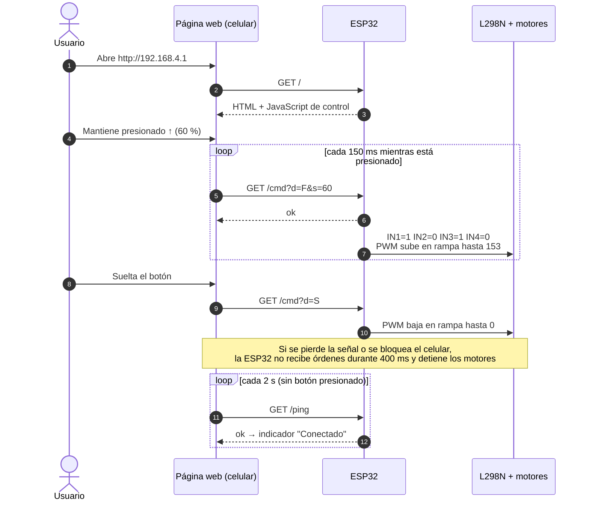
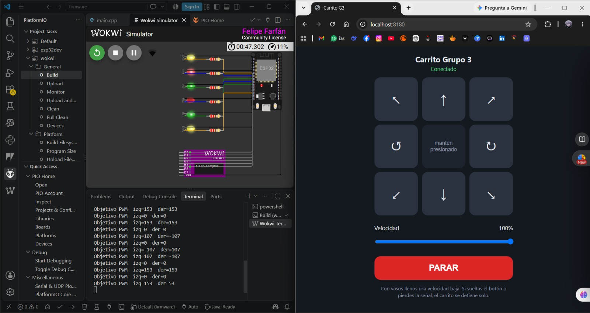

# Carrito de transporte 4WD controlado por WiFi

Módulo del **Sistema de Logística de Monedas Inteligentes** · Grupo 3 · Micros y Laboratorio · UMNG

El carrito transporta el dron y los vasos con monedas que el dron no puede cargar. Una **ESP32** crea su propia red WiFi y sirve una página web de control. Desde el navegador del celular se maneja el carrito con botones de dirección y una barra de velocidad. La ESP32 mueve los 4 motorreductores mediante un **puente H L298N**.

| Característica | Valor |
|---|---|
| Microcontrolador | ESP32 DevKit V1 (30 pines) |
| Tracción | 4WD diferencial (tipo tanque): 4 motorreductores TT 1:48 |
| Driver | L298N (2 canales, 2 motores en paralelo por canal) |
| Alimentación de motores | Batería Ni-MH 7,2 V, 500 mAh |
| Alimentación de la ESP32 | Power bank 5 V por USB |
| Comunicación | WiFi 2,4 GHz, modo punto de acceso, HTTP |
| Control | Página web embebida en la ESP32 (celular o PC) |
| Seguridad | Parada automática si no llegan órdenes en 400 ms |

---

## Contenido de la carpeta

```
carrito_transporte/
├── README.md
├── firmware/                  Proyecto PlatformIO (VS Code)
│   ├── platformio.ini         entornos: esp32dev (real) y wokwi (simulación)
│   ├── src/main.cpp           firmware + página web de control
│   ├── diagram.json           circuito de simulación en Wokwi
│   └── wokwi.toml             configuración del simulador Wokwi para VS Code
└── docs/
    ├── img/                   esquema eléctrico y diagramas en PNG/SVG
    └── diagramas/             fuentes: esquema_electrico.py y archivos .mmd (Mermaid)
```

---

## 1. Diagrama de bloques



## 2. Esquema eléctrico



*Versión vectorial: [`docs/img/esquema_electrico.svg`](docs/img/esquema_electrico.svg). Se regenera con `python docs/diagramas/esquema_electrico.py`.*

### Tabla de conexiones

| ESP32 | L298N | Función |
|---|---|---|
| D13 | ENA | PWM, velocidad del lado izquierdo |
| D27 | IN1 | Dirección del lado izquierdo |
| D26 | IN2 | Dirección del lado izquierdo |
| D25 | IN3 | Dirección del lado derecho |
| D33 | IN4 | Dirección del lado derecho |
| D32 | ENB | PWM, velocidad del lado derecho |
| GND | GND | Tierra común (obligatoria) |

| Potencia | Conexión |
|---|---|
| Batería (+) 7,2 V | Conector J1 → borne +12V del L298N |
| Batería (−) | Borne GND del L298N |
| OUT1 / OUT2 | Motores M1 (delantero) y M2 (trasero) del lado izquierdo, en paralelo |
| OUT3 / OUT4 | Motores M3 (delantero) y M4 (trasero) del lado derecho, en paralelo |
| Power bank 5 V | Puerto USB de la ESP32 |
| Borne 5V del L298N | Sin conexión (jumper 5V-EN puesto) |

**Decisiones de diseño**

- **Jumpers ENA y ENB retirados** para controlar la velocidad por PWM y así acelerar y frenar suave, sin tumbar los vasos.
- **La ESP32 se alimenta aparte.** El regulador de 5 V del L298N necesita unos 7 V de entrada, y la batería de 7,2 V baja de ese valor al descargarse o cuando arrancan los motores. Esas caídas reiniciaban la ESP32; con un power bank independiente y la tierra común, el control queda estable.
- **El conector de la batería funciona como interruptor.** Los interruptores deslizantes pequeños soportan unos 0,3–0,5 A, menos de lo que piden 4 motores TT al arrancar.
- **Dos motores en paralelo por lado.** Así el control es diferencial: izquierda y derecha, igual que un tanque, con solo 2 canales del driver.

---

## 3. Firmware

Archivo: [`firmware/src/main.cpp`](firmware/src/main.cpp)

- **Red WiFi propia:** `Carrito_G3` (clave `monedas123`), página en `http://192.168.4.1`. No necesita router ni internet.
- **Servidor web** con tres rutas:

  | Ruta | Uso |
  |---|---|
  | `/` | Entrega la página de control (HTML + CSS + JavaScript guardados en la flash) |
  | `/cmd?d=<dir>&s=<vel>` | Orden de movimiento. `d`: `F`, `B`, `L`, `R`, `FL`, `FR`, `BL`, `BR`, `S` (soltar), `X` (parar ya). `s`: velocidad 0–100 % |
  | `/ping` | Latido para mostrar el estado "Conectado" |

- **Mantener presionado:** la página repite la orden cada 150 ms mientras el botón está presionado.
- **Parada de seguridad:** si pasan 400 ms sin órdenes (se suelta el botón, se bloquea el celular, se pierde la señal), los motores se detienen solos.
- **Rampas de aceleración:** la velocidad sube de a poco y baja más rápido, para no volcar los vasos.
- **Zona muerta:** cuando hay que moverse, el PWM nunca baja de 90/255, porque por debajo de eso los motores TT zumban pero no giran.
- **Giros en el sitio al 70 %** de la velocidad, y avance con curva (diagonales) moviendo un lado al 35 %.
- **Control alterno por monitor serial:** `w` `a` `s` `d` para moverse y `x` o espacio para parar. Sirve para depurar y para simular en wokwi.com.
- **Controles de teclado** en la página (flechas o WASD) para probar desde el PC.

### Diagrama de flujo



### Secuencia de comunicación



---

## 4. Simulación en Wokwi

Como el simulador no tiene un modelo del L298N ni de motores DC, el circuito simulado usa **6 LEDs en los pines que van al puente H** y un **analizador lógico**:

| LED | Pin | Qué muestra |
|---|---|---|
| ENA (amarillo) | D13 | Brillo = velocidad del lado izquierdo (PWM) |
| IN1 (verde) / IN2 (rojo) | D27 / D26 | Sentido del lado izquierdo: verde = adelante, rojo = atrás |
| IN3 (verde) / IN4 (rojo) | D25 / D33 | Sentido del lado derecho |
| ENB (amarillo) | D32 | Brillo = velocidad del lado derecho (PWM) |

El analizador lógico registra las 6 señales en los canales D0–D5 (ENA, IN1, IN2, IN3, IN4, ENB). Al detener la simulación descarga un archivo `.vcd` que se puede abrir en [PulseView](https://sigrok.org/wiki/PulseView) para ver el PWM y las rampas.

Wokwi no permite que la ESP32 cree su propia red (modo AP). Por eso el entorno `wokwi` de `platformio.ini` define `WOKWI_SIM`, y con eso la ESP32 se conecta a la red virtual `Wokwi-GUEST`. El resto del código es idéntico al del carrito real.

### Opción A — Wokwi para VS Code (recomendada: se usa la misma página web)

1. En VS Code instala la extensión **Wokwi Simulator** y activa la licencia gratuita: `F1` → *Wokwi: Request a New License*.
2. Abre la carpeta `firmware/` con PlatformIO.
3. Compila el entorno de simulación: en la barra de PlatformIO elige el entorno **`env:wokwi`** y dale a *Build*. También sirve la terminal: `pio run -e wokwi`.
4. `F1` → **Wokwi: Start Simulator**. Se abre el circuito con la ESP32, los LEDs y el analizador.
5. Cuando el monitor serial diga `Simulacion lista`, abre **http://localhost:8180** en el navegador del PC. `wokwi.toml` reenvía ese puerto al servidor web de la ESP32 simulada.
6. Maneja el carrito con los botones o con las flechas del teclado: los LEDs muestran la dirección y el brillo de los amarillos sube y baja con las rampas.

### Opción B — wokwi.com (sin instalar nada)

1. Crea un proyecto nuevo **ESP32** en [wokwi.com](https://wokwi.com).
2. En la pestaña `diagram.json`, pega el contenido de [`firmware/diagram.json`](firmware/diagram.json).
3. En `sketch.ino`, pega el contenido de `main.cpp` y agrega en la **primera línea**: `#define WOKWI_SIM`.
4. Inicia la simulación. En la versión web gratuita no se puede abrir la página de control desde el PC, así que se maneja desde el **monitor serial**: escribe `w`, `a`, `s`, `d` o `x` y presiona Enter. Cada orden dura 2 s.

Al simular, el monitor serial muestra cada cambio de orden, por ejemplo `Objetivo PWM  izq=153  der=153` al avanzar al 60 %.

---

## 5. Uso del carrito real

1. Sube el firmware con el entorno **`env:esp32dev`**: `pio run -e esp32dev -t upload`. Hazlo con la batería de los motores desconectada.
2. Conecta la ESP32 al power bank y luego la batería al conector J1.
3. En el celular, conéctate a la red **Carrito_G3** (clave `monedas123`). Si aparece "sin internet", elige mantener la conexión y apaga los datos móviles.
4. Abre **http://192.168.4.1**, mantén presionadas las flechas y ajusta la velocidad. Con vasos llenos usa 40–50 %.

### Problemas comunes

| Síntoma | Causa probable | Solución |
|---|---|---|
| Un lado no se mueve con ninguna orden | Cable de ENA/ENB en el pin de 5V del header, cable flojo o sin GND común | Revisar el cableado; poner temporalmente el jumper ENx para aislar la falla |
| Un lado gira al revés | Polaridad de los motores | Intercambiar los dos cables de ese lado en OUTx, o `INVERTIR_IZQ` / `INVERTIR_DER = true` |
| Los motores zumban pero no giran | PWM bajo o batería descargada | Subir la velocidad o cargar la batería |
| Se pierde la conexión con la ESP32 en power bank | El power bank se apaga por bajo consumo | Modo de baja corriente del power bank o una resistencia de carga de 68 Ω / 1 W entre VIN y GND |
| La ESP32 se reinicia al arrancar los motores | Caída de tensión | Alimentar la ESP32 aparte y revisar la tierra común |

---

## 6. Evidencias

### Carrito real controlado desde el celular

https://github.com/user-attachments/assets/35945fbb-97b9-4319-9416-f12bc0e77dda

### Simulación en Wokwi con la página de control



*Izquierda: ESP32 simulada con los 6 LEDs y el analizador lógico; la terminal muestra el PWM objetivo de cada lado. Derecha: la página de control abierta en `http://localhost:8180`.*

https://github.com/user-attachments/assets/7c5e395b-8c42-489d-a63f-32fe6b14f254
