# Parcial Segundo Corte – Sistema de Logística de Monedas Inteligentes

**Universidad Militar Nueva Granada – Ingeniería Mecatrónica · Campus Cajicá**<br>
**Asignatura:** Micros y Laboratorio<br>
**Grupo 3** · Elemento diferencial: agente inteligente tipo **Jarvis** que comanda todo el sistema<br>
**Integrantes:**

- Faber Alexander Rodriguez Hernandez
- David Felipe Farfan Quiroz
- Kevin Philip Castelblanco Ramirez

El objetivo del proyecto es un **sistema logístico de monedas** basado en **ESP32**. El sistema cuenta las monedas y las reconoce, las clasifica por denominación en vasos y las transporta hasta una meta. Todo se supervisa por WiFi desde un dashboard con un asistente (Jarvis) que expone los datos del proceso. Este repositorio reúne los **avances del segundo corte**: la simulación completa en **PyBullet**, el reconocimiento real de monedas con **ESP32-CAM** y su interfaz web en tiempo real, el **carrito de transporte** construido y funcionando por WiFi, y el **dron** de transporte diseñado y simulado.

| Módulo | Qué hace | Tecnología | Estado |
|---|---|---|---|
| **Planta de clasificación** | Dispensador → banda transportadora → estación de reconocimiento → 3 servomotores con paleta que empujan cada moneda a su vaso | PyBullet + URDF propio | Simulado |
| **Reconocimiento de monedas** | Reconoce 7 monedas colombianas (nuevas y antiguas), las cuenta una sola vez, guarda la foto y muestra valor y cantidad en vivo | ESP32-CAM (OV5640) + YOLO11 en el PC + interfaz web | **Funcionando con la cámara real** |
| **Carrito de transporte 4WD** | Lleva el dron y los vasos que el dron no puede cargar; se maneja desde el celular | ESP32 + L298N + página web embebida | **Construido y probado**, también simulado en Wokwi |
| **Dron de transporte** | Despega a 1,20 m, vuela 1 m hasta el punto B, entrega la moneda y regresa; detecta obstáculos | ESP32-S3 (diseño), PID en cascada | Diseñado, presupuestado y simulado |
| **Agente Jarvis y dashboard** | Chatbot que expone los datos del proyecto; seguimiento de ruta y métricas | Agente de IA | Próxima fase |

**Resultados principales de este corte**

| | Resultado |
|---|---|
| Reconocimiento | Modelo de 8 clases (7 monedas + "sin moneda"). En la prueba honesta, con una foto de cada moneda apartada del entrenamiento, acertó **417 de 420 variantes (99,3 %)**. Funciona en vivo con la ESP32-CAM |
| Carrito | Control desde el celular por WiFi propio, con **parada de seguridad en 400 ms** si se pierde la señal y rampas de aceleración para no tumbar los vasos. Probado en físico y en Wokwi |
| Dron (simulación) | Con 10 g de carga, T/W = **2,28**. Misión completa de despegue, crucero, entrega, retorno y aterrizaje en **14,5 s**; entregó a **3,3 cm** del punto B y aterrizó a **4 cm** del origen |
| Planta (simulación) | En 40 s simulados clasificó **16 monedas** en sus vasos (9 de $1.000, 5 de $500 y 2 de $200) |

---

## Contenido

1. [Arquitectura del sistema](#1-arquitectura-del-sistema)
2. [Simulación de la planta en PyBullet](#2-simulación-de-la-planta-en-pybullet)
3. [Reconocimiento de monedas con ESP32-CAM](#3-reconocimiento-de-monedas-con-esp32-cam)
4. [Carrito de transporte 4WD por WiFi](#4-carrito-de-transporte-4wd-por-wifi)
5. [Dron de transporte de monedas](#5-dron-de-transporte-de-monedas)
6. [Materiales y software](#6-materiales-y-software)
7. [Paso a paso para replicarlo](#7-paso-a-paso-para-replicarlo)
8. [Estructura del repositorio](#8-estructura-del-repositorio)
9. [Problemas comunes y soluciones](#9-problemas-comunes-y-soluciones)
10. [Estado del proyecto y próximos pasos](#10-estado-del-proyecto-y-próximos-pasos)
11. [Conclusiones](#11-conclusiones)
12. [Referencias](#12-referencias)

---

## 1. Arquitectura del sistema

### 1.1 Diagrama de bloques general

Cada módulo tiene su propio microcontrolador y se comunica por WiFi. El trabajo pesado (visión artificial, interfaz y, más adelante, el agente Jarvis) corre en el PC. Las ESP32 se encargan del tiempo real con el hardware: cámara, motores, servos y sensores.

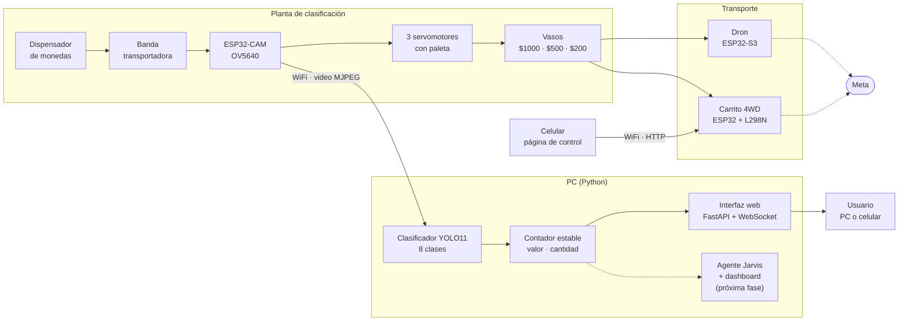

### 1.2 Recorrido de una moneda

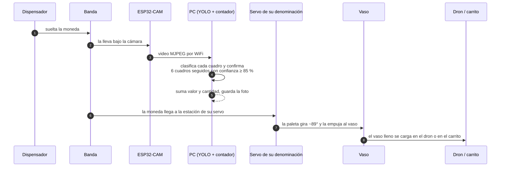

### 1.3 Comunicación entre módulos

| Enlace | Medio | Protocolo | Estado |
|---|---|---|---|
| ESP32-CAM → PC | WiFi 2,4 GHz (red local) | HTTP, video MJPEG en `:81/stream`; ajustes por `/control` | Funcionando |
| PC → navegador | Red local | HTTP + WebSocket (estado cada cuadro) + MJPEG anotado | Funcionando |
| Celular → carrito | WiFi propio de la ESP32 (`Carrito_G3`) | HTTP GET `/cmd` cada 150 ms mientras se presiona | Funcionando |
| PC ↔ dron | WiFi | Telemetría UDP (diseñada en la simulación) | Próxima fase |
| PC ↔ servos de la planta | WiFi | Orden de empuje por denominación | Próxima fase |

---

## 2. Simulación de la planta en PyBullet

### 2.1 Qué hace

La planta completa está modelada en un **URDF propio** ([`urdf/planta_servos_v4.urdf`](urdf/planta_servos_v4.urdf)): una máquina dispensadora con tolva, una banda recta de 8 m, un pórtico de reconocimiento y **tres estaciones de servomotor con paleta**, una por denominación, cada una con su vaso al lado. Al final de la banda espera el dron.

El script [`sim/05_planta_servos.py`](sim/05_planta_servos.py) genera una moneda cada 1,8 s. La moneda sale de la máquina, avanza por la banda a 0,35 m/s y pasa por el pórtico, donde queda "reconocida". Cuando llega a la estación de su denominación, la paleta de ese servo gira ~89° y la empuja al vaso. Si la moneda no es de esa estación, la paleta no se mueve y la moneda sigue hasta el siguiente servo. En pantalla se ve el conteo de cada vaso.

| Estación | Posición en la banda | Moneda |
|---|---|---|
| Reconocimiento | x = 0,3 m | Todas |
| Servo 1 | x = 1,5 m | $1.000 |
| Servo 2 | x = 3,5 m | $500 |
| Servo 3 | x = 5,5 m | $200 |
| Dron | x = 7,5 m | Recibe los vasos |

### 2.2 Captura

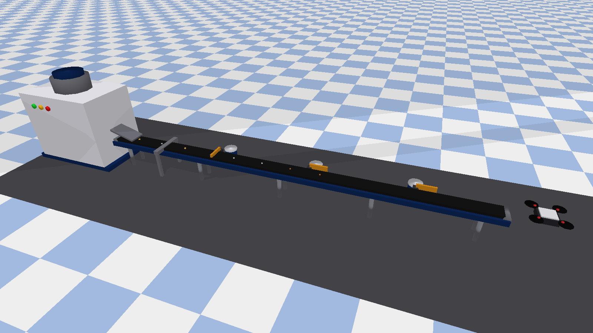

*Planta completa: la máquina dispensadora (izquierda) suelta las monedas sobre la banda. Luego pasan por el pórtico de reconocimiento y por las tres estaciones de servo (paletas naranjas, cada una con su vaso). Al final está el dron.*

### 2.3 Evolución del modelo

El modelo partió del URDF que compartió el profesor ([dialejobv/U_Militar](https://github.com/dialejobv/U_Militar), guardado como [`urdf/maqueta_original.urdf`](urdf/maqueta_original.urdf)) y se rediseñó en cuatro versiones:

| Versión | Archivo | Cambio | Script |
|---|---|---|---|
| v1 | `planta_monedas_v1.urdf` | Se reparó el árbol del URDF: un solo link raíz, sin links huérfanos | `sim/01_ver_planta.py` |
| v2 | `planta_monedas_v2.urdf` | Brazos robóticos de 3 GDL con pinza, cada articulación controlable con sliders | `sim/02_mover_brazos.py` |
| v3 | `planta_monedas_v3.urdf` | Banda en L de tres tramos; el dron como cuerpo libre de 6 GDL | `sim/03_planta_con_dron.py`, `sim/04_monedas.py` |
| **v4** | `planta_servos_v4.urdf` | **Banda recta y 3 servos con paleta**, que reemplazan los brazos: más simple, más barato y más confiable | `sim/05_planta_servos.py` |

`sim/00_diagnostico_urdf.py` revisa cualquier URDF antes de cargarlo: cuenta links y joints y encuentra raíces múltiples o links huérfanos.

### 2.4 Análisis

**La banda no se mueve: se mueve lo que está encima.** En PyBullet una banda real (muchos eslabones) es costosa e inestable. Por eso el link de la banda queda fijo, y en cada paso se le impone a cada moneda que está sobre ella una velocidad de avance de 0,35 m/s, más un término que la centra en la banda:

$$v_y = \text{sat}\big(K_c\,(0 - y),\; \pm v_{max}\big), \qquad K_c = 3,\; v_{max} = 0{,}5\ \text{m/s}$$

Así las monedas no se acumulan contra los bordes ni se caen de la banda.

**Filtro de colisiones entre monedas.** Las monedas están en un grupo de colisión propio que no choca consigo mismo. Así no se traban unas contra otras a la salida de la máquina, que era el problema de la v3: se quedaban estancadas al inicio de la banda.

**Empuje confiable.** La paleta tiene colisión real y se anima con control de posición (`POSITION_CONTROL`, 15 N·m, 6 rad/s). Además, mientras está extendida, a la moneda se le da una velocidad lateral de 0,9 m/s hacia el vaso. Así el resultado no depende de que el contacto paleta-moneda salga perfecto en cada corrida. La moneda queda clasificada cuando llega a la altura del vaso (y ≥ 0,55 m).

**Por qué servos y no brazos.** En la v2 y la v3 cada brazo necesitaba 3 servos y una pinza para mover una moneda de 7 a 10 g. Un solo servo con paleta hace lo mismo con una sola orden (empujar o no). Eso baja el costo y el consumo, y deja una lógica de control sencilla para la ESP32.

---

## 3. Reconocimiento de monedas con ESP32-CAM

### 3.1 Qué hace

Una **ESP32-CAM** (placa AI-Thinker, sensor OV5640) transmite video por WiFi. En el PC, un clasificador **YOLO11n-cls** entrenado con nuestras monedas reconoce cuál está frente a la cámara. Un **contador estable** registra cada moneda una sola vez y guarda su foto. Una **interfaz web en tiempo real** muestra el video, la moneda detectada con su confianza, el valor total procesado, la cantidad por denominación y el historial.

Reconoce **7 monedas en sus dos caras**: $1.000; $500 nueva y antigua; $200 nueva y antigua; y $100 nueva y antigua. También reconoce la clase **"sin moneda"**, necesaria para que el modelo no "vea" una moneda cuando no hay nada.

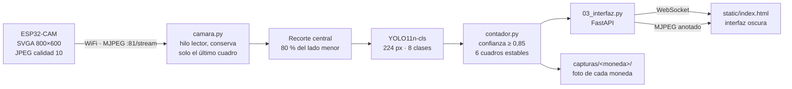

### 3.2 Capturas de la interfaz

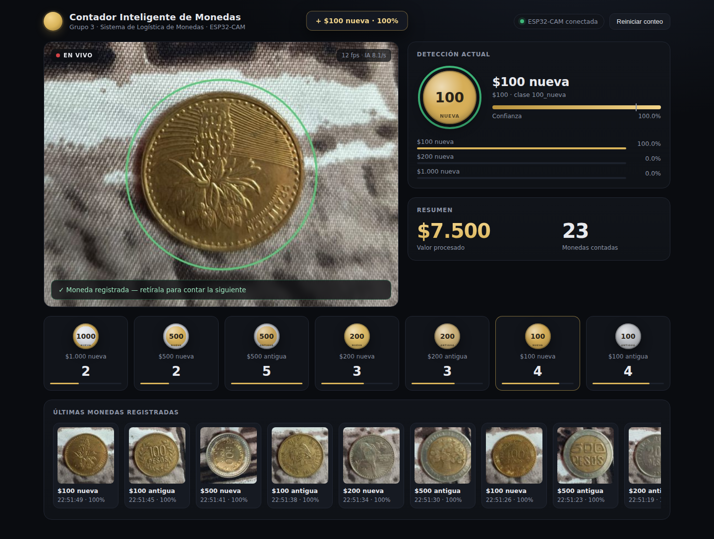

*Moneda de $100 nueva registrada (círculo verde) con 100 % de confianza. Arriba a la derecha, el resumen del valor procesado y la cantidad; abajo, el contador por denominación y las últimas monedas registradas con su foto.*

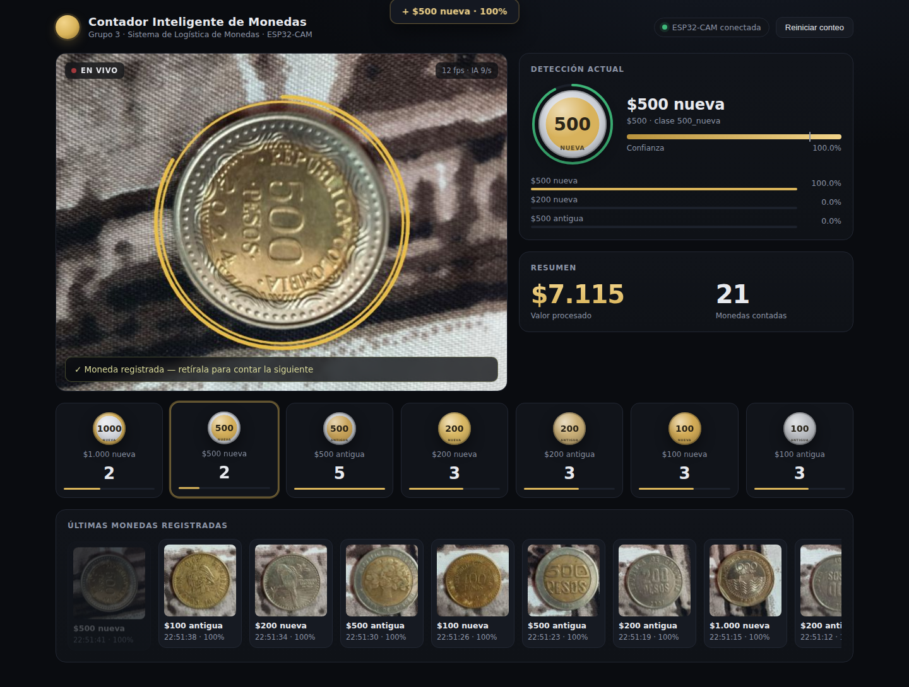

*Mientras confirma, el círculo se pone dorado y se va llenando. Solo cuenta la moneda cuando la ve 6 cuadros seguidos con la misma clase y una confianza de al menos 85 %.*

<p align="center">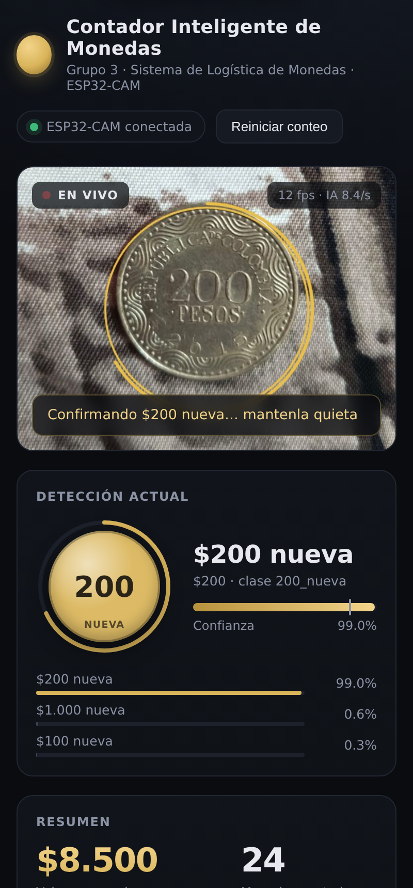</p>

*La misma interfaz desde el celular, en la misma red WiFi: `http://<IP-del-PC>:8000`.*

> Estas capturas se tomaron con el modelo real clasificando las fotos de nuestras monedas. En vivo la fuente es la ESP32-CAM.

### 3.3 Dataset y entrenamiento

Para avanzar rápido, el modelo se entrenó **solo con 25 fotos tomadas con el celular** (ambas caras de cada moneda). Cada foto se recortó centrada en la moneda ([`vision/referencias/`](vision/referencias)):

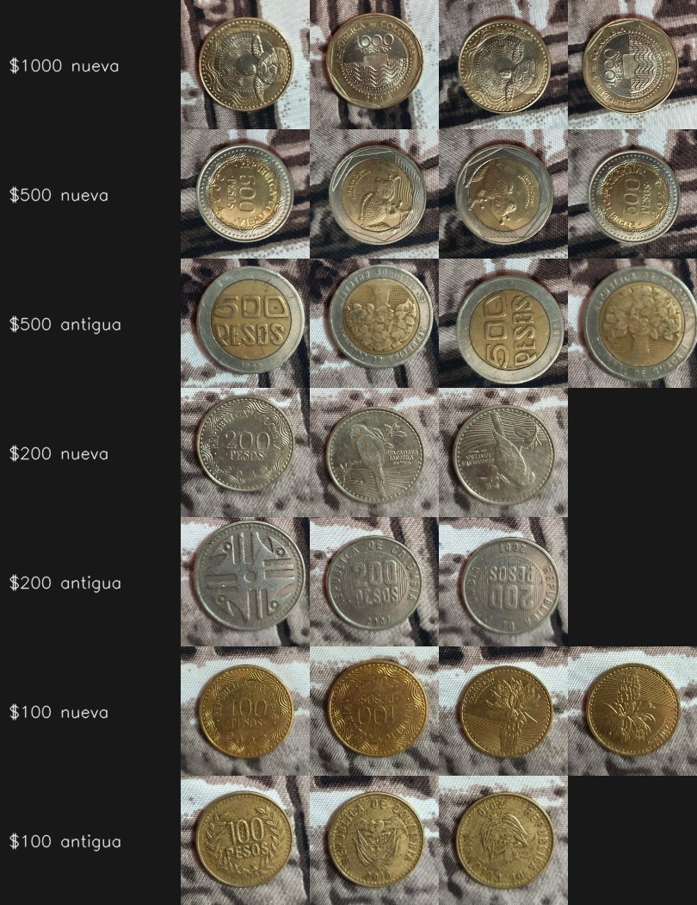

Con tan pocas fotos, el modelo memorizaría el fondo y el ángulo. Por eso [`vision/00_importar_referencias.py`](vision/00_importar_referencias.py) genera **60 variantes por foto** que imitan a la ESP32-CAM:

| Variación | Rango | Para qué |
|---|---|---|
| Giro | 0 a 360° | La moneda llega en cualquier ángulo |
| Tamaño en el cuadro | 36 a 86 % | La distancia a la cámara cambia |
| Inclinación | Hasta 15 % de achatamiento | La moneda no siempre está paralela al lente |
| Posición | ±12 % del cuadro | No siempre queda centrada |
| Fondo | Tela real (60 %) o liso sintético | Que el modelo mire la moneda, no el fondo |
| Brillo, tinte y saturación | Brillo ×0,6 a ×1,3; tinte ±15 % por canal; saturación ×0,6 a ×1,25 | Luz del salón y virado de color del OV5640 |
| Baja resolución, desenfoque, ruido | Aleatorio | Calidad de la cámara |
| Compresión JPEG | Calidad 45 a 90 | Igual que el stream de la ESP32 |

La clase "sin moneda" sale de 150 recortes de tela sin moneda y de fondos sintéticos. En total hay **1.500 imágenes de monedas y 240 de fondo**.

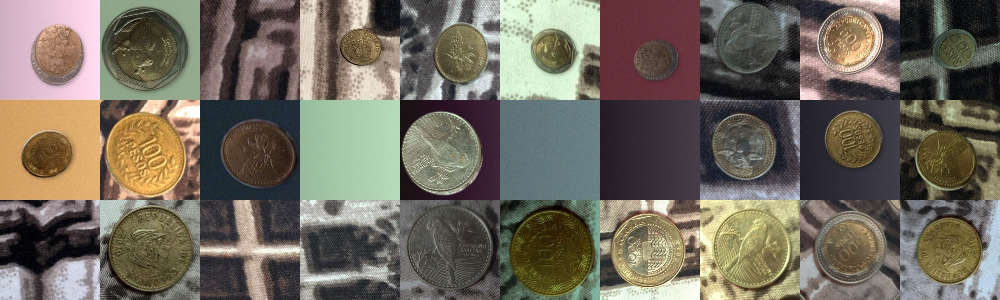

*Ejemplos de variantes generadas: la misma moneda con otro giro, tamaño, fondo y luz.*

El entrenamiento ([`vision/02_entrenar.py`](vision/02_entrenar.py)) usa **YOLO11n-cls** preentrenado, a 224 px y 20 épocas, con `fliplr = 0` porque una moneda espejada no existe en la realidad.

### 3.4 Resultados

La validación normal con estas variantes daría 100 % y no probaría nada, porque salen de las mismas fotos. Por eso se hizo una **prueba honesta**: se apartó **una foto de cada moneda** (7 fotos), se entrenó sin ellas y se evaluó el modelo sobre esas fotos que nunca vio.

| Prueba | Resultado |
|---|---|
| Fotos apartadas, 12 variantes suaves cada una | **84 de 84** |
| Fotos apartadas, 60 variantes duras cada una (otro tamaño, inclinación, fondo y luz) | **417 de 420 (99,3 %)** |
| Errores | $200 nueva → $100 nueva (2) y $100 nueva → $200 nueva (1) |
| Modelo final (entrenado con las 25 fotos), sobre las fotos originales | **25 de 25** |

Los únicos errores son entre $200 nueva y $100 nueva, que tienen tamaño y diseño parecidos. Nunca confundió una moneda nueva con su versión antigua, que era el riesgo principal. Luego se probó en vivo con la ESP32-CAM y reconoce bien las 7 monedas.

### 3.5 Contador estable

[`vision/contador.py`](vision/contador.py) evita contar dos veces la misma moneda y contar monedas falsas:

1. **Confirmar:** una moneda se cuenta solo si aparece con la misma clase y confianza ≥ 0,85 durante **6 cuadros seguidos**.
2. **Registrar:** suma su valor, guarda la foto en `capturas/<moneda>/` y la agrega al historial.
3. **Rearmar:** no vuelve a contar hasta ver **5 cuadros seguidos sin moneda**. Así, dejar la moneda quieta no la cuenta dos veces.

### 3.6 Configuración de la ESP32-CAM

Se usa el ejemplo **CameraWebServer** de Arduino-ESP32 con tres cambios:

| Archivo | Cambio | Por qué |
|---|---|---|
| `board_config.h` | Solo `#define CAMERA_MODEL_AI_THINKER` activo | Con `ESP_EYE` la ESP32 busca la cámara en otros pines y falla con `Camera probe failed 0x106` |
| `CameraWebServer.ino` | `config.frame_size` y `set_framesize` en `FRAMESIZE_SVGA` (800×600) | El ejemplo arranca en QVGA (320×240): muy poco detalle para distinguir antigua de nueva |
| `CameraWebServer.ino` | `config.jpeg_quality = 10` | Mejor calidad de imagen |

Desde el PC, [`vision/config.py`](vision/config.py) aplica al arrancar el volteo vertical y apaga el flash, porque el metal refleja y satura la foto. Estos ajustes se pierden cada vez que la ESP32 se reinicia.

---

## 4. Carrito de transporte 4WD por WiFi

### 4.1 Qué hace

El carrito transporta **el dron y los vasos con monedas que el dron no puede cargar**. Una **ESP32** crea su propia red WiFi (`Carrito_G3`) y sirve una página web de control. Desde el navegador del celular se maneja con botones de dirección (8 direcciones más giros en el sitio) y una barra de velocidad. La ESP32 mueve los 4 motorreductores con un **puente H L298N** en tracción diferencial, como un tanque.

Toda la documentación técnica del carrito está en [`carrito_transporte/README.md`](carrito_transporte/README.md).

### 4.2 Video del carrito real

https://github.com/user-attachments/assets/35945fbb-97b9-4319-9416-f12bc0e77dda

### 4.3 Simulación en Wokwi

Wokwi no tiene modelo del L298N ni de motores DC. Por eso el circuito simulado pone **6 LEDs en los pines que van al puente H** (verde y rojo para el sentido, amarillo con brillo según el PWM) y un **analizador lógico**. Corre el **mismo firmware** del carrito real y se controla con la **misma página web**, abierta en `http://localhost:8180`.

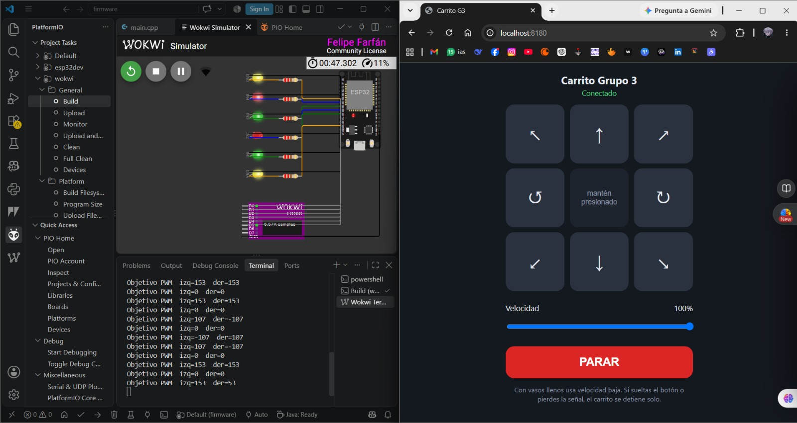

*A la izquierda, la simulación en Wokwi para VS Code: la ESP32, los 6 LEDs y el analizador lógico. En la terminal se ve el PWM objetivo de cada lado según la orden. A la derecha, la página de control "Carrito Grupo 3" en estado **Conectado**, con los botones de dirección, la velocidad y el botón PARAR.*

https://github.com/user-attachments/assets/7c5e395b-8c42-489d-a63f-32fe6b14f254

### 4.4 Diagrama de bloques

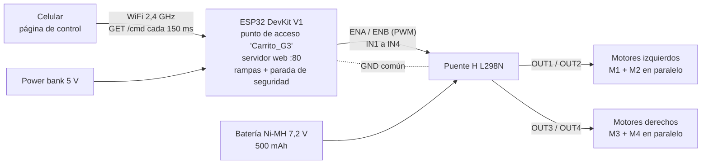

### 4.5 Esquema eléctrico

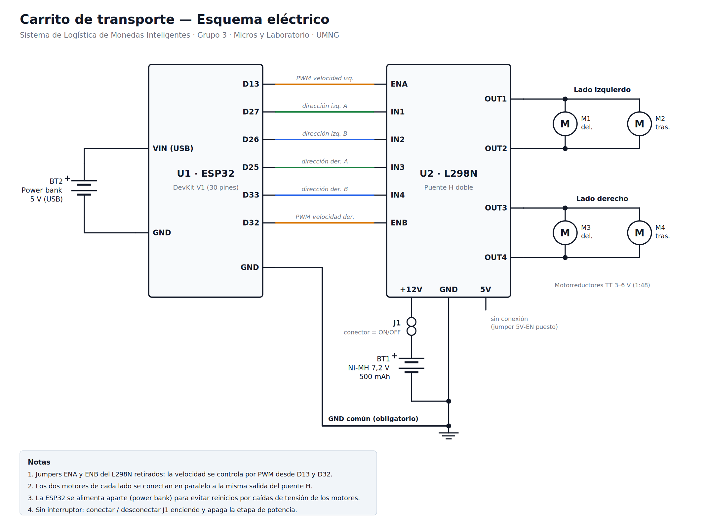

| ESP32 | L298N | Función |
|---|---|---|
| D13 | ENA | PWM, velocidad del lado izquierdo |
| D27 / D26 | IN1 / IN2 | Sentido del lado izquierdo |
| D25 / D33 | IN3 / IN4 | Sentido del lado derecho |
| D32 | ENB | PWM, velocidad del lado derecho |
| GND | GND | Tierra común (obligatoria) |

**Decisiones de diseño**

- **La ESP32 se alimenta aparte, con un power bank.** El regulador de 5 V del L298N necesita unos 7 V de entrada, y la batería de 7,2 V baja de ese valor cuando arrancan los motores. Esas caídas reiniciaban la ESP32.
- **Jumpers ENA y ENB retirados** para controlar la velocidad por PWM y así acelerar y frenar suave, sin tumbar los vasos.
- **Dos motores en paralelo por lado:** control diferencial con solo 2 canales del driver.
- **El conector de la batería hace de interruptor**, porque un interruptor deslizante pequeño no aguanta la corriente de arranque de 4 motores TT.

### 4.6 Firmware

Archivo: [`carrito_transporte/firmware/src/main.cpp`](carrito_transporte/firmware/src/main.cpp) (PlatformIO, entornos `esp32dev` para el carrito real y `wokwi` para la simulación).

| Función | Cómo |
|---|---|
| Red propia | Punto de acceso `Carrito_G3`, página en `http://192.168.4.1`. No necesita router ni internet |
| Órdenes | `/cmd?d=<F,B,L,R,FL,FR,BL,BR,S,X>&s=<0-100>`; la página la repite cada 150 ms mientras se mantiene presionado |
| Parada de seguridad | Si pasan **400 ms** sin órdenes (se suelta el botón, se bloquea el celular o se pierde la señal), los motores se detienen |
| Rampas | La velocidad sube de a 6 pasos de PWM cada 10 ms y baja de a 15: arranque suave, frenado rápido |
| Zona muerta | Si hay que moverse, el PWM nunca baja de 90/255, porque por debajo los motores TT zumban pero no giran |
| Giros | En el sitio al 70 % de la velocidad; en diagonal, un lado va al 35 % |
| Depuración | Monitor serial con `w` `a` `s` `d` `x`; teclado (flechas o WASD) en la página |

La velocidad objetivo de cada lado se calcula a partir de la dirección y del porcentaje de la barra. Por ejemplo, al avanzar al 60 %:

$$PWM = \text{round}(0{,}60 \times 255) = 153$$

Es exactamente el valor `izq=153 der=153` que muestra la terminal en la simulación de Wokwi.

---

## 5. Dron de transporte de monedas

### 5.1 Qué hace

El dron recoge una moneda al final de la banda, **despega a 1,20 m**, vuela **1 m** hasta el punto B, baja, **suelta la moneda** y regresa a aterrizar. Un sensor IR frontal detecta obstáculos: si hay uno, el dron se detiene en el aire hasta que el camino quede libre, y ese evento está pensado para reportarse al agente Jarvis.

La simulación está en [`Dron_Monedas/simulacion_dron.py`](Dron_Monedas/simulacion_dron.py) con el modelo [`Dron_Monedas/dron_monedas.urdf`](Dron_Monedas/dron_monedas.urdf). En pantalla hay sliders para cambiar la altura, la distancia, activar un obstáculo, cambiar la masa de la carga en pleno vuelo y pasar a modo manual.

### 5.2 Video de la simulación

https://github.com/user-attachments/assets/355e377f-305f-4d8a-aa03-f76a17315ee6

### 5.3 Captura

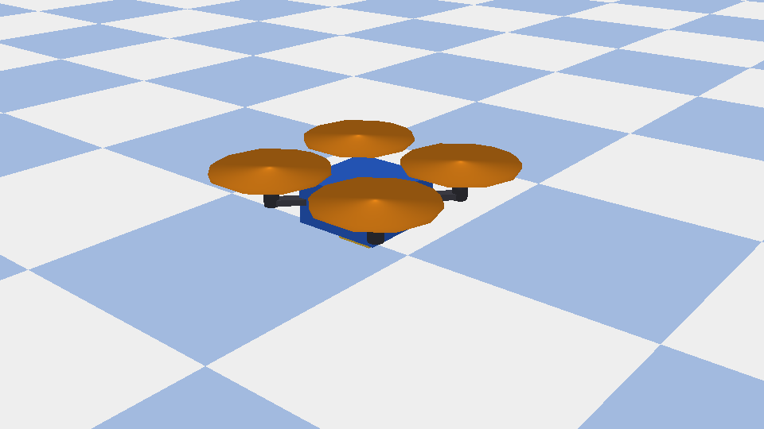

*Modelo URDF del dron: chasis impreso en 3D (azul), 4 motores coreless 8520 con hélices de 75 mm y la cuna porta-monedas debajo.*

### 5.4 Diseño y selección de componentes

El presupuesto de peso, empuje y costos está en [`Dron_Monedas/Presupuesto_Dron_Monedas_v2.xlsx`](Dron_Monedas/Presupuesto_Dron_Monedas_v2.xlsx).

| Componente | Selección | Justificación |
|---|---|---|
| Controlador | ESP32-S3 SuperMini | WiFi integrado, 4 g, base obligatoria del proyecto |
| Motores | 4 × coreless 8520 + hélice de 75 mm | 52 g de empuje estimado por motor a 4,2 V |
| Driver | 4 MOSFET AO3400 + diodo 1N5819 | Soportan 5,7 A, sobrados para motores con escobillas |
| IMU | MPU6050 | Lazo de actitud (sin ella el dron se voltea en 0,55 s) |
| Altura | VL53L0X (ToF, 2 m) | Suficiente para volar a 1,20 m; más barato que el VL53L1X |
| Obstáculos | IR FC-51 frontal | $6.000 frente a $38.000 del sensor ToF |
| Batería | LiPo 1S 450 mAh | 4 a 6 min de vuelo, suficiente para la demostración |
| Chasis | PLA impreso en 3D | 20 g, se imprime en la universidad |

**Relación empuje/peso (T/W)**, el criterio de diseño:

$$\frac{T}{W} = \frac{4 \times 52\ \text{g}}{81{,}2\ \text{g (seco)} + 10\ \text{g (carga)}} = \frac{208}{91{,}2} = 2{,}28$$

Para transporte lento y estable el objetivo es T/W ≥ 2,0, así que la carga máxima es de unos **22,8 g**, más del doble de los 10 g pedidos (1 moneda de $1.000 o 2 de $500).

**Costo:** $170.200 COP con el plan de compra mixto (importado + local) y 15 % de contingencia, dentro del tope de $200.000 del dron.

### 5.5 Control

La arquitectura de control es la misma que se cargará en la ESP32-S3:

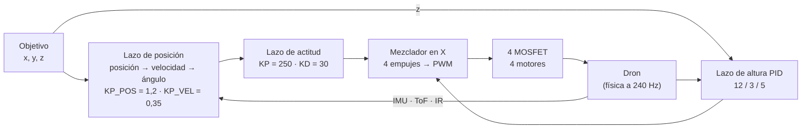

La máquina de estados de la misión:

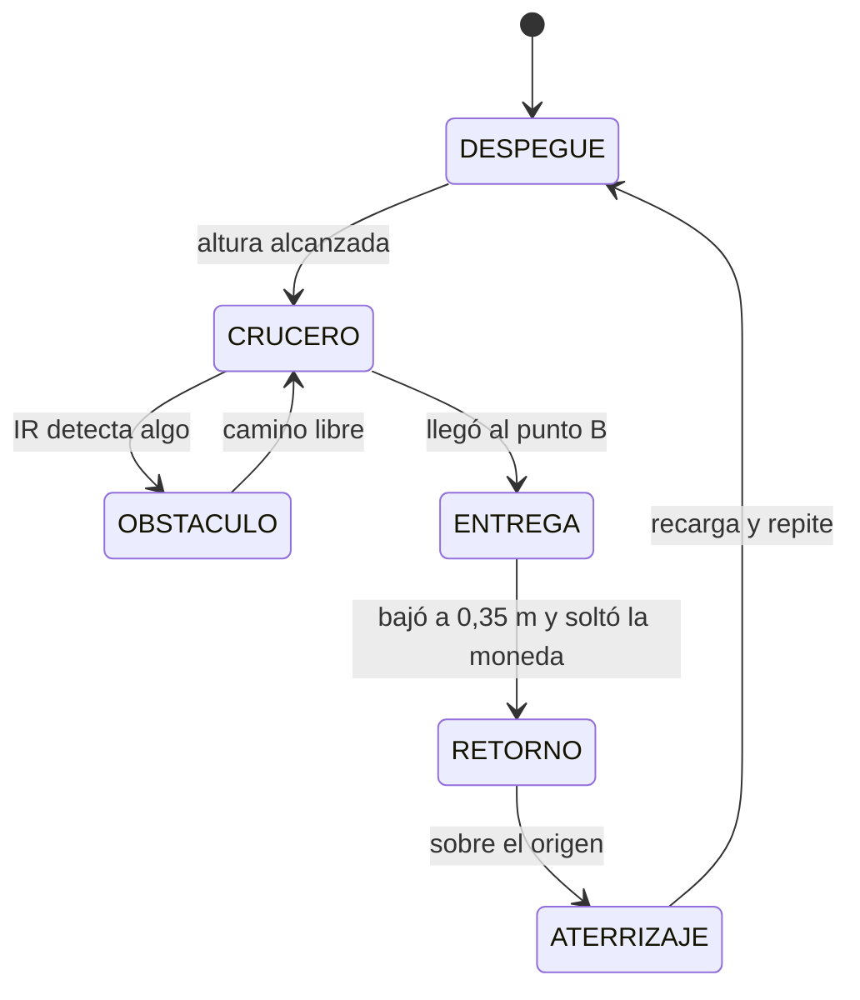

**El controlador no conoce la masa real.** Usa una masa **nominal** (dron + 10 g), igual que el firmware real, que no sabe cuánto pesa lo que le pusieron encima. El margen de empuje limita la velocidad y la inclinación máximas. Por eso, con más carga, el dron viaja visiblemente más despacio: **2,4 s para recorrer 1 m con 10 g y 3,5 s con 60 g**.

### 5.6 Resultados de la simulación

Misión completa con 10 g de carga, sin obstáculo ([registro a 240 Hz](docs/evidencias/dron_mision_log.csv)):

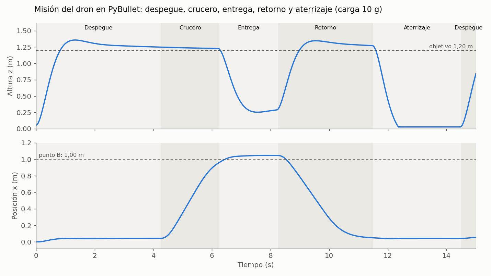

| Métrica | Resultado |
|---|---|
| Tiempo de subida (10 % a 90 % de 1,20 m) | 0,59 s |
| Altura máxima al despegar | 1,36 m (sobrepaso del 13 %) |
| Altura media en crucero | 1,24 m (desviación de 0,6 cm) |
| Error en el punto de entrega | 3,3 cm |
| Posición al aterrizar | a 4,2 cm del origen |
| Duración de un ciclo completo | 14,5 s |

La gráfica muestra dos cosas por mejorar en el lazo de altura: un sobrepaso del 13 % al despegar, y que en crucero el dron sigue unos 4 cm por encima del objetivo mientras la altura todavía se asienta. Para el siguiente ajuste se probará una rampa de altura más suave en el despegue y activar la integral solo cerca del objetivo.

**Limitación conocida:** sin sensor de flujo óptico (PMW3901, descartado por costo: $95.000), el dron real no mantiene la posición horizontal por sí solo y deriva despacio. Para un trayecto de 1 m que dura pocos segundos la deriva es pequeña, y el agente puede corregirla con órdenes de avance.

---

## 6. Materiales y software

**Hardware**

| Módulo | Componentes |
|---|---|
| Reconocimiento | ESP32-CAM AI-Thinker con sensor OV5640 y placa programadora ESP32-CAM-MB (FT232R); cargador de pared 5 V / 2 A |
| Carrito | ESP32 DevKit V1 (30 pines), puente H L298N, chasis 4WD con 4 motorreductores TT 1:48, batería Ni-MH 7,2 V 500 mAh, power bank 5 V |
| Dron (diseño) | ESP32-S3 SuperMini, 4 motores 8520 + hélices 75 mm, 4 MOSFET AO3400, MPU6050, VL53L0X, FC-51, MT3608, LiPo 1S 450 mAh, TP4056, chasis PLA |

**Software**

| Herramienta | Versión | Uso |
|---|---|---|
| Windows | 11 | Sistema operativo |
| VS Code + PlatformIO | – | Firmware del carrito |
| Wokwi Simulator para VS Code | – | Simulación del carrito |
| Arduino IDE | 1.8.19 | Firmware de la ESP32-CAM (CameraWebServer) |
| Miniconda | – | Entorno de Python con PyBullet compilado |
| Python | 3.12 (entorno `monedas_g3`) | Simulaciones, visión e interfaz |
| pybullet | conda-forge | Simulación física de la planta y el dron |
| ultralytics (YOLO11), PyTorch | ≥ 8.3 | Entrenamiento y reconocimiento |
| OpenCV, NumPy, requests | – | Video de la ESP32-CAM y procesamiento de imagen |
| FastAPI + uvicorn | – | Servidor de la interfaz web (WebSocket) |

---

## 7. Paso a paso para replicarlo

### Paso 1: Clonar el repositorio

```bash
git clone https://github.com/faberx10/Parcial_Monedas.git
cd Parcial_Monedas
```

### Paso 2: Crear el entorno de Python (una sola vez)

En el **Anaconda Prompt**:

```bash
conda create -n monedas_g3 python=3.12 -y
conda activate monedas_g3
conda install -c conda-forge pybullet -y
pip install -r requirements.txt
```

PyBullet se instala con conda porque `pip install pybullet` falla en Windows: no hay instalador precompilado y pide Visual C++.

### Paso 3: Simulación de la planta

```bash
python sim/05_planta_servos.py
```

### Paso 4: Simulación del dron

```bash
cd Dron_Monedas
python simulacion_dron.py
```

Mueve el slider "Masa de la carga" en pleno vuelo para ver cómo el dron se frena, o pon "Obstáculo" en 1.

### Paso 5: Reconocimiento de monedas

1. Instala PyTorch con soporte para la GPU (copia el comando de [pytorch.org](https://pytorch.org/get-started/locally/)) y luego el resto:
   ```bash
   pip install -r vision/requirements_vision.txt
   ```
2. En Arduino IDE abre *Archivo → Ejemplos → ESP32 → Camera → CameraWebServer*, haz los tres cambios de la [sección 3.6](#36-configuración-de-la-esp32-cam), pon tu red WiFi y súbelo (IO0 a GND, RST, subir, quitar el puente, RST). Aliméntala con cargador de pared.
3. Copia la IP que muestra el Monitor Serie en `ESP32_IP` de `vision/config.py`.
4. Inicia la interfaz y abre **http://localhost:8000**:
   ```bash
   cd vision
   python 03_interfaz.py
   ```
   Sin cámara, `python 03_interfaz.py --demo` muestra la interfaz con datos simulados.
5. Para reentrenar (opcional), agrega fotos a `vision/referencias/<moneda>/` y ejecuta:
   ```bash
   python 00_importar_referencias.py --validar
   python 02_entrenar.py --ya-preparado --epocas 20
   python 00_importar_referencias.py
   python 02_entrenar.py --ya-preparado --epocas 20
   ```

### Paso 6: Carrito

1. En VS Code: **PlatformIO → Open Project** → `carrito_transporte/firmware`.
2. Carrito real: entorno `esp32dev` → **Upload** (con la batería de los motores desconectada). En el celular, conéctate a `Carrito_G3` (clave `monedas123`) y abre `http://192.168.4.1`.
3. Simulación: entorno `wokwi` → **Build**, luego `F1` → **Wokwi: Start Simulator** y abre `http://localhost:8180`.

---

## 8. Estructura del repositorio

```
Parcial_Monedas/
├── README.md
├── requirements.txt               ← dependencias de las simulaciones
├── .gitignore
├── docs/
│   ├── capturas/                  ← capturas de la planta, el dron, la interfaz y Wokwi
│   └── evidencias/                ← registro de la misión del dron y su gráfica
├── urdf/                          ← modelos de la planta (v1 a v4), del dron y la maqueta original
├── sim/                           ← simulaciones de la planta en PyBullet (00 a 05)
├── Dron_Monedas/
│   ├── dron_monedas.urdf
│   ├── simulacion_dron.py         ← simulación con control en cascada y misión
│   └── Presupuesto_Dron_Monedas_v2.xlsx
├── vision/                        ← reconocimiento de monedas con la ESP32-CAM
│   ├── config.py                  ← IP de la cámara, clases y umbrales
│   ├── camara.py                  ← lectura del video MJPEG sin retraso
│   ├── contador.py                ← cuenta cada moneda una sola vez
│   ├── 00_importar_referencias.py ← dataset a partir de las fotos de referencia
│   ├── 01_capturar_dataset.py     ← captura de fotos con la ESP32-CAM
│   ├── 02_entrenar.py             ← entrenamiento y matriz de confusión
│   ├── 03_interfaz.py             ← servidor de la interfaz en tiempo real
│   ├── static/index.html          ← interfaz web
│   ├── referencias/               ← 25 fotos de las monedas y fondos
│   ├── modelos/monedas.pt         ← modelo entrenado
│   └── README.md
└── carrito_transporte/            ← carrito 4WD por WiFi
    ├── README.md                  ← documentación completa del carrito
    ├── firmware/                  ← PlatformIO: esp32dev y wokwi
    └── docs/                      ← esquema eléctrico y diagramas
```

---

## 9. Problemas comunes y soluciones

| Problema | Causa | Solución |
|---|---|---|
| `pip install pybullet` pide Microsoft Visual C++ 14.0 | No hay instalador precompilado de PyBullet para Windows | Instalarlo con `conda install -c conda-forge pybullet` en el entorno `monedas_g3` |
| `No module named 'pybullet'` | La terminal está en el entorno `base` | `conda activate monedas_g3` antes de ejecutar |
| Conda pide aceptar términos de servicio | Política nueva de los canales de Anaconda | Ejecutar los `conda tos accept` que muestra el mensaje |
| El URDF no carga o las piezas quedan sueltas | Comentarios XML con `--` o varios links raíz | Revisar con `sim/00_diagnostico_urdf.py` |
| Monedas estancadas al inicio de la banda | Chocaban entre sí y con la rampa | Filtro de colisión entre monedas y rampa solo visual (v4) |
| ESP32-CAM: `Camera probe failed with error 0x106` | `board_config.h` con un modelo distinto (por ejemplo `ESP_EYE`) | Dejar activo solo `CAMERA_MODEL_AI_THINKER` |
| ESP32-CAM no sube el programa (write timeout) | Driver o puerto equivocado; la placa MB usa FT232R | Instalar el driver FTDI y elegir el COM correcto; IO0 a GND al subir |
| ESP32-CAM se reinicia (brownout) o el video sale con franjas rosadas | Alimentación insuficiente desde el USB del PC | Cargador de pared 5 V / 2 A y cable corto |
| `sin conexion... reintentando` en el PC | IP cambió o hay otra pestaña viendo el stream | Actualizar `ESP32_IP`; cerrar la página de la ESP32 (solo atiende un video a la vez) |
| La IP de la ESP32-CAM cambió | Otra red (módem vs. hotspot del celular) | Leer la IP nueva en el Monitor Serie |
| El carrito se reinicia al arrancar los motores | Caída de la batería por debajo de lo que pide el regulador del L298N | ESP32 con power bank aparte y tierra común |
| Un lado del carrito gira al revés | Polaridad de los motores | Intercambiar los cables en OUTx o poner `INVERTIR_IZQ` / `INVERTIR_DER = true` |
| Los motores zumban pero no giran | PWM bajo o batería descargada | Subir la velocidad o cargar la batería |

---

## 10. Estado del proyecto y próximos pasos

| Objetivo específico del parcial | Avance |
|---|---|
| Arquitectura del sistema con diagramas de bloques por módulo y selección de materiales | Diagramas de todo el sistema, de la planta, de la visión, del carrito y del dron; justificación de componentes del carrito y del dron |
| Diseño mecánico y electrónico (CAD, planos, esquemas; PyBullet + URDF opcional) | URDF propio de la planta y del dron; esquema eléctrico del carrito. Pendientes: CAD y planos de la planta |
| Primeros módulos construidos (se aceptan simulados en PyBullet) | Carrito construido y funcionando; reconocimiento funcionando con la cámara real; planta y dron simulados |
| Aplicación web comunicada de forma inalámbrica con la ESP32 | Interfaz web con la ESP32-CAM por WiFi y página de control del carrito por WiFi |

**Siguientes pasos**

1. **Dashboard en Streamlit** con el seguimiento de la ruta y las variables de peso, cantidad y valor, alimentado por el contador de monedas.
2. **Agente Jarvis:** chatbot que responde con los datos del sistema (monedas procesadas, valor, estado del dron y del carrito).
3. **Integración de la planta real:** banda y 3 servos comandados por una ESP32 según la moneda que reconoce la cámara.
4. **Construcción del dron** siguiendo el presupuesto y el plan de armado.
5. **CAD y planos** de la planta, y la trayectoria con los tres obstáculos hasta la meta.

---

## 11. Conclusiones

- **Separar el tiempo real del cómputo pesado simplificó cada módulo.** Las ESP32 solo leen la cámara o mueven motores; el PC hace la visión, el conteo y la interfaz. Así, cambiar el modelo o la interfaz no obliga a tocar el firmware.
- **Medir con datos que el modelo no vio es lo que da confianza en el reconocimiento.** La validación normal daba 100 % sin probar nada. Apartar una foto por moneda mostró 99,3 % y dónde están los errores reales ($200 nueva y $100 nueva).
- **La simulación ahorró hardware.** En PyBullet se descartaron los brazos de 3 GDL a favor de servos con paleta, y en el dron se comprobó que la selección de motores da T/W = 2,28 antes de comprar nada.
- **La seguridad se diseña desde el firmware.** La parada del carrito a los 400 ms sin órdenes y las rampas de aceleración resolvieron dos riesgos reales: perder el control con la señal caída y tumbar los vasos al arrancar.
- **La alimentación fue la causa de la mayoría de fallas de hardware.** Tanto la ESP32-CAM (brownout, franjas en el video) como el carrito (reinicios al arrancar) se estabilizaron alimentando la electrónica de control aparte de la de potencia.

---

## 12. Referencias

- Coumans, E. y Bai, Y. *PyBullet Quickstart Guide*. https://docs.google.com/document/d/10sXEhzFRSnvFcl3XxNGhnD4N2SedqwdAvK3dsihxVUA
- dialejobv. *U_Militar* (modelo URDF base del proyecto). https://github.com/dialejobv/U_Militar
- Ultralytics. *YOLO11 Image Classification*. https://docs.ultralytics.com/tasks/classify/
- Espressif Systems. *esp32-camera driver*. https://github.com/espressif/esp32-camera
- Espressif Systems. *Arduino-ESP32: CameraWebServer example*. https://github.com/espressif/arduino-esp32/tree/master/libraries/ESP32/examples/Camera/CameraWebServer
- Espressif Systems. *Arduino-ESP32 LEDC (PWM) API*. https://docs.espressif.com/projects/arduino-esp32/en/latest/api/ledc.html
- STMicroelectronics. *L298 Dual Full-Bridge Driver, datasheet*.
- Wokwi. *Wokwi for VS Code*. https://docs.wokwi.com/vscode/getting-started
- FastAPI. *WebSockets*. https://fastapi.tiangolo.com/advanced/websockets/
- GitHub Docs. *Attaching files*. https://docs.github.com/en/get-started/writing-on-github/working-with-advanced-formatting/attaching-files
